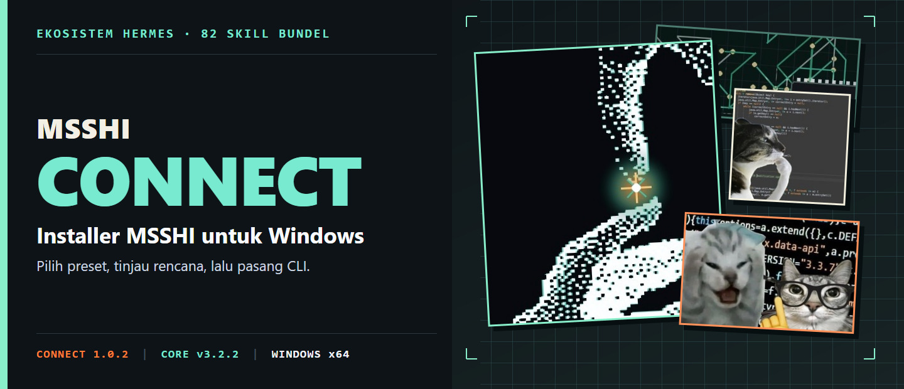

<p align="center"></p>

#  MSSHI Installer &amp; Connect

Aplikasi desktop dan CLI mandiri berbasis **Rust + Vanilla JavaScript** untuk menyiapkan instalasi MSSHI dan mengenali aplikasi yang dapat digunakan bersama Hermes di Windows. Connect membantu pengguna memeriksa perangkat, menentukan kebutuhan, menyimpan rencana, dan memasang launcher Core resmi setelah konfirmasi.

**Versi 1.0.2** · **Upstream Resmi:** [MSSHI-Mega-Semar-Sang-Hyang-Ismaya (`v3.2.2+`)](https://github.com/zidanaisar624/MSSHI-Mega-Semar-Sang-Hyang-Ismaya) · **Aplikasi Kembaran Diagnostik:** [MSSHI-DOCTOR](https://github.com/zidanaisar624/MSSHI-DOCTOR)

[](https://saweria.co/muzas)

---

## Mulai di Windows

[**Unduh EXE Windows x64**](https://github.com/zidanaisar624/MSSHI-CONNECT/releases/download/v1.0.2/MSSHI-Connect-Portable-win-x64.exe) · [ZIP portabel](https://github.com/zidanaisar624/MSSHI-CONNECT/releases/download/v1.0.2/MSSHI-Connect-1.0.2-windows-x64.zip) · [Checksum SHA-256](https://github.com/zidanaisar624/MSSHI-CONNECT/releases/download/v1.0.2/SHA256SUMS.txt)

1. Buka EXE, lalu periksa lokasi MSSHI dan ruang yang tersedia. Antarmuka menggunakan browser lokal.
2. Pilih jenis kebutuhan dan simpan rencana. Status `PLANNED` berarti preferensi telah dicatat.
3. Klik **Pasang CLI Core v3.2.2** untuk memasang launcher resmi GitHub. Proses ini memerlukan Git, Python 3.10+, internet, dan konfirmasi pengguna. Connect memeriksa commit rilis yang tetap sebelum pemasangan.
4. Setelah berhasil, buka folder `bin` pada lokasi MSSHI yang ditampilkan. Jalankan `.\msshi.cmd setup` dari PowerShell untuk menentukan preset dan pengaturan Hermes.

Connect 1.0.2 memasang tag stabil v3.2.2 (82 skill bundel + 6 opt-in, 76 sumber upstream). Katalog versi GitHub dapat menampilkan pembaruan yang lebih baru. Pilihan versi dan preferensi Auto-Upgrade di Connect merupakan data rencana hingga tersedia mekanisme penerapan versi tersebut. Memeriksa ulang koneksi menyimpan peta aplikasi, dan konfigurasi profil dilanjutkan melalui wizard Core. Untuk pemulihan file yang telah dicatat Doctor, gunakan aplikasi [MSSHI Doctor](https://github.com/zidanaisar624/MSSHI-DOCTOR/releases/tag/v1.2.1).

Pemeriksaan Connect tidak memakai model AI. Aplikasi memisahkan pemasangan launcher dari setup bot. Pemilihan provider, model, alamat endpoint, dan kunci API dilakukan pengguna.

## Cara Menjalankan di Windows
1. **Paket Portabel Windows x64:** Ekstrak ZIP lalu klik dua kali **`MSSHI-Connect.exe`** atau **`MSSHI_Connect.bat`**.
2. **Langsung dari Kode Sumber (Node.js 20+):** Klik dua kali **`MSSHI_Connect.bat`** atau jalankan pemeriksaan berikut. Jalur ini menyediakan pratinjau rencana, sedangkan pemasangan memerlukan EXE Rust:
   ```powershell
   .\msshi-connect.cmd --probe
   .\msshi-connect.cmd --check-updates
   ```
3. **Untuk Pengembang (Rust + JS):**
   ```powershell
   node --test tests/connect.test.mjs
   cargo test --workspace
   cargo build --release --bin msshi-connect
   ```

## Dukung Pengembangan / Support

[](https://saweria.co/muzas)

Proyek inti **MSSHI Installer &amp; Connect** tetap **open-source (MIT)** dan bebas digunakan. Dukungan sukarela melalui [Saweria (`https://saweria.co/muzas`)](https://saweria.co/muzas) membantu riset, pengujian perangkat low-spec, dan pembaruan rutin ekosistem MSSHI.
