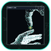

<p align="center"></p>

#  MSSHI Installer &amp; Connect

Aplikasi desktop &amp; CLI mandiri (**Rust + Vanilla JavaScript**, 100% terpisah dari `MSSHI Core` dan `MSSHI Doctor`) untuk memasang **MSSHI** ke **Hermes Agent** (Windows 11), memilih **Auto-Upgrade ON/OFF** (termasuk pemisahan cerdas *update masalah sistem otomatis tanpa tanya* vs *fitur baru dengan warning &amp; pilihan per fitur*) atau **Pilih Versi Mandiri** langsung dari GitHub (`v3.2.1`, `v3.1.2`, `main`, dan rilis masa depan), serta menghubungkan **5 Bot ↔ CLI-Anything / Opt-in MCP ↔ Aplikasi** dalam satu antarmuka Cyber-Noir yang sangat ringan *(mengacu pada benchmark efisiensi Win10 RAM 4 GB — saking ringannya komponen MSSHI &amp; Connect sanggup berjalan di spek serendah itu)*.

**Versi 1.0.0** · **Upstream Resmi:** [MSSHI-Mega-Semar-Sang-Hyang-Ismaya (`v3.2.1+`)](https://github.com/zidanaisar624/MSSHI-Mega-Semar-Sang-Hyang-Ismaya) · **Aplikasi Kembaran Diagnostik:** [MSSHI-DOCTOR](https://github.com/zidanaisar624/MSSHI-DOCTOR)

[](https://saweria.co/muzas)

---

## Fitur Utama
- **Koneksi GitHub Langsung (`ETag` Cache):** Memantau tag stabil (`v3.1.2`, `v3.2.1`, dst.) & branch `main` tanpa full-clone dan tetap aman saat offline/rate-limited.
- **Auto-Upgrade ON/OFF + Pemilih Versi Mandiri:** Bebas menyalakan *Auto-Upgrade* (dengan konfirmasi 1-klik) atau mematikannya untuk mengunci (*pin*) versi pilihan sendiri + pratinjau `CHANGELOG.md` + **Rollback 1-Klik**.
- **5 Kartu Preset Keperluan Klien:** *Belajar*, *Konten Kreasi (Higgsfield 9 modul & Lemo-Opuscar)*, *Riset & Skripsi*, *Coding & Security*, dan *Kombinasi Preset MuZA 5 Bot*.
- **Connect Hub (`Bot ↔ CLI-Anything ↔ Apps`):** Scanner aplikasi lokal/web, *Auto-Reconnect*, preferensi browser deklaratif tanpa sentuh cookie, dan **`auto_open_on_boot: FALSE`** terkunci permanen.
- **Pengaman Windows Kritis:** Proteksi **3-Zona** (0 sentuh `provider`, `model`, `API key`, `.env`, `SOUL.md` kustom, maupun folder privat), **Anti-Admin-Lock Guard**, **Auto-Temp Redirect ke Drive D:/E:**, preflight memori add-on ML, dan **0 panggilan LLM berbayar**.
- **Tombol Pintas Opsional:** Dapat membuka aplikasi terpisah **MSSHI Doctor** dari header bila terpasang.

## Cara Menjalankan di Windows
1. **Paket Portabel Windows x64 (GitHub Actions):** Ekstrak ZIP lalu klik dua kali **`MSSHI-Connect.exe`** atau **`MSSHI_Connect.bat`**.
2. **Langsung dari Kode Sumber (Node.js 20+):** Klik dua kali **`MSSHI_Connect.bat`** atau jalankan:
   ```powershell
   .\msshi-connect.cmd --probe
   .\msshi-connect.cmd --check-updates
   ```
3. **Untuk Pengembang (Rust + JS):**
   ```powershell
   node --test tests/connect.test.mjs
   cargo test --workspace
   cargo build --release --bin msshi-connect
   ```

## Dukung Pengembangan / Support

[](https://saweria.co/muzas)

Proyek inti **MSSHI Installer &amp; Connect** tetap **open-source (MIT)** dan bebas digunakan. Dukungan sukarela melalui [Saweria (`https://saweria.co/muzas`)](https://saweria.co/muzas) membantu riset, pengujian perangkat low-spec, dan pembaruan rutin ekosistem MSSHI.
